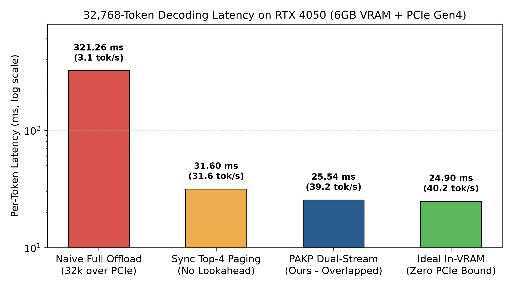
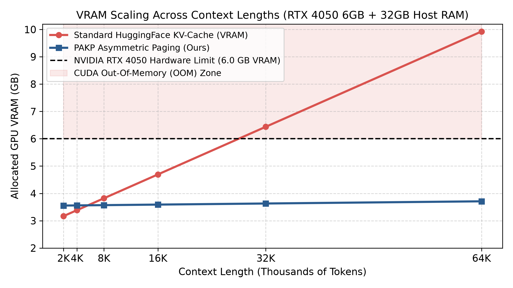

# PAKP: Predictive Asymmetric KV-Paging for Edge GPUs

### Long-context LLM inference through asymmetric memory, centered page indexing, and cross-layer asynchronous prefetching.

[](https://doi.org/10.5281/zenodo.23915486)
[](https://pytorch.org/)
[](https://developer.nvidia.com/cuda-toolkit)
[](https://www.python.org/)
[](LICENSE)
[](https://pypi.org/project/pakp-engine/)

**Research preprint:** [10.5281/zenodo.23915486](https://doi.org/10.5281/zenodo.23915486) · **Implementation:** [andromechanic/pakp-engine](https://github.com/andromechanic/pakp-engine)

</div>

---

## Overview

**PAKP (`pakp-engine`)** is a research framework and two-tier asymmetric KV-cache paging implementation for running long-context transformer inference on memory-constrained consumer GPUs.

The core idea is to treat page-locked host memory as an asynchronous backing tier for historical KV-cache pages, while keeping the information needed for the current decoding step in GPU memory. PAKP combines:

1. **Two-tier asymmetric memory:** historical 64-token KV pages in page-locked host RAM, with attention sinks, a local window, and a compact page index retained in VRAM.
2. **Centered bounding-box page descriptors:** layer-wise key-mean centering plus per-page channel-wise minima, maxima, and centered means to improve the scoring of pages containing sparse, high-value tokens.
3. **RoPE-aligned cross-layer lookahead:** next-layer query estimation and page scoring on a dedicated CUDA stream, allowing selected host-to-device transfers to overlap with current-layer computation.

The reported evaluation uses an **ASUS TUF F15 with an NVIDIA RTX 4050 Laptop GPU (6 GB VRAM) and 32 GB host RAM**.

> PAKP is an experimental research implementation. The measurements below describe the reported test configurations; they should not be interpreted as universal performance guarantees across models, GPUs, drivers, or workloads.

## At a glance

| Reported result | Value | Evaluation context |
|---|---:|---|
| PAKP decoding latency | **25.54 ms/token** | 32,768-token benchmark |
| PAKP throughput | **39.2 tokens/s** | Same benchmark |
| Measured host-to-device bandwidth | **11.81 GB/s** | PCIe Gen4 telemetry |
| Paging overhead hidden | **90.5%** | Relative to synchronous Top-4 paging and the ideal in-VRAM reference |
| Distance from ideal reference | **0.64 ms/token** | 25.54 ms vs. 24.90 ms |
| Active KV VRAM | **3.64 GB** | Reported PAKP passkey ablation |
| Passkey retrieval | **100% in the reported test** | Qwen2.5-1.5B-Instruct ablation |

## Visual benchmarks

The following figures summarize the reported evaluation on the ASUS TUF F15 (RTX 4050 6 GB VRAM + 32 GB host RAM).

<p align="center">
  
  
</p>

---

## Why KV-cache memory becomes a bottleneck

Model weights remain relatively fixed during generation, but the KV cache grows with the number of tokens retained in the context. For batch size 1, the approximate KV-cache storage added per token is:

\[
M_{\text{token}} = 2 \times L \times H_{KV} \times D_H \times B
\]

where:

- \(L\) is the number of transformer layers;
- \(H_{KV}\) is the number of key/value heads;
- \(D_H\) is the head dimension;
- \(B\) is the number of bytes per element;
- the factor of 2 accounts for keys and values.

For the **28-layer, 8-KV-head, 128-dimension, FP16 configuration** used for the cache-size estimate, this is **112 KiB per token**:

| Context length | Approximate KV-cache size |
|---:|---:|
| 8,192 tokens | 0.875 GiB |
| 16,384 tokens | 1.75 GiB |
| 32,768 tokens | 3.50 GiB |
| 65,536 tokens | 7.00 GiB |

These estimates describe the stated configuration and exclude model weights, activations, CUDA workspaces, allocator overhead, and other runtime allocations. Actual memory use depends on the model architecture, batch size, cache format, and inference implementation.

Two straightforward strategies have limitations:

- **Full-cache offload** moves the capacity pressure to host memory, but repeated transfers can make PCIe bandwidth and synchronization part of the per-token critical path.
- **Sliding-window eviction** bounds the active cache, but older information is no longer available unless a retrieval mechanism can bring the relevant pages back.

PAKP explores a third approach: retain a compact page index on the GPU, predict which historical pages are relevant, and prefetch only those pages while other GPU work is running.

---

## Architecture

### 1. Two-tier asymmetric memory topology

PAKP separates the active working set from historical KV-cache storage.

| Memory tier | Contents | Role |
|---|---|---|
| **Tier 1 — GPU VRAM** | Model weights, 4 attention-sink tokens, 256-token local window, compact page index, and active runtime data | Keeps the model and current decoding working set close to the GPU |
| **Tier 2 — Page-locked host RAM** | Historical KV-cache pages, each containing 64 tokens | Provides a host-memory backing tier for pages that are not kept resident in VRAM |

Host buffers are allocated using `cudaMallocHost` so CUDA can perform direct memory transfers without first staging data through pageable host buffers. PAKP selects pages for transfer rather than moving the entire historical cache on every decoding step.

### 2. Centered subspace bounding-box index

Key states can be anisotropic: many token representations share a strong layer-wise background component. A page descriptor based only on an uncentered average can under-represent a distinctive token inside that page.

For each layer, PAKP subtracts the global Key mean \(\bar{K}_L\), then records page-level descriptors:

- \(\mu_p\): centered page mean;
- \(K_{\min}^{(p)}\): channel-wise minimum;
- \(K_{\max}^{(p)}\): channel-wise maximum.

The descriptor is used to score candidate pages against the predicted query. Retaining channel-wise extrema is intended to preserve sharp, localized deviations that a centroid-only representation may smooth out.

### 3. RoPE-aligned cross-layer lookahead

PAKP uses the current layer's hidden state to estimate the next layer's query representation. The predicted query is projected with the next layer's query weights and aligned with Rotary Position Embeddings (RoPE) before candidate page scoring.

The reported residual-stream cosine similarity is **0.9842** for the evaluated setup. This observation motivates the lookahead strategy; it is not a claim that adjacent-layer representations are identical for every model or input.

The execution design uses two CUDA streams:

| Stream | Work |
|---|---|
| `compute_stream` | Current layer attention and feed-forward computation |
| `prefetch_stream` | Next-layer query projection, RoPE alignment, page scoring, and asynchronous Top-4 DMA prefetch |

The objective is to perform page selection and host-to-device transfer while the current layer is computing, reducing the portion of transfer latency exposed on the decoding critical path.

---

## Empirical results

### 32,768-token decoding benchmark

Reported on the RTX 4050 Laptop GPU with 6 GB VRAM.

| Execution strategy | Per-token latency | Throughput | Paging overhead hidden |
|---|---:|---:|---:|
| Naive full KV offload | 321.26 ms | 3.1 tokens/s | 0.0% |
| Synchronous Top-4 paging (no lookahead) | 31.60 ms | 31.6 tokens/s | 0.0% |
| **PAKP dual-stream lookahead** | **25.54 ms** | **39.2 tokens/s** | **90.5%** |
| Ideal in-VRAM reference (zero PCIe transfer) | 24.90 ms | 40.2 tokens/s | — |

The reported **90.5%** is the fraction of the synchronous-paging-to-ideal latency gap closed by PAKP:

\[
\frac{31.60 - 25.54}{31.60 - 24.90} \times 100 \approx 90.5\%
\]

PAKP's measured latency was **0.64 ms/token** above the ideal in-VRAM reference in this benchmark. The ideal row is a reference bound, not a competing implementation.

### Live passkey-retrieval ablation

Reported for `Qwen2.5-1.5B-Instruct`. This is a separate live-model ablation and should not be compared directly with the 32K-context latency benchmark above.

| Method | Evicted page hit | Active VRAM | Speed | Reported output / observation |
|---|---:|---:|---:|---|
| Sliding window (`Sinks + Win`) | `False` | 3.61 GB | 46.6 tokens/s | `123456` — missed the target passkey |
| Uncentered mean paging | `False` | 3.64 GB | 26.8 tokens/s | Missed the needle page |
| **PAKP centered BBox** | **`True`** | **3.64 GB** | **27.1 tokens/s** | **`7392-OMEGA.` — retrieved the target passkey** |

The 100% figure refers to the reported passkey-retrieval test, not a guarantee of perfect retrieval across arbitrary prompts, models, or context lengths.

---

## Installation

### Requirements

The package metadata specifies:

- Python **3.10+**
- PyTorch **2.1.0+**
- Transformers **4.42.0+**
- Accelerate **0.30.0+**
- Matplotlib **3.8.0+**
- An NVIDIA GPU and compatible CUDA-enabled PyTorch build for GPU execution and CUDA benchmarks

The benchmark hardware used for the reported results was an NVIDIA RTX 4050 Laptop GPU with 6 GB VRAM and 32 GB host RAM. Other configurations may behave differently.

### Set up an environment

Create and activate a virtual environment:

```bash
python -m venv .venv
source .venv/bin/activate

python -m pip install --upgrade pip
```

Install a CUDA-enabled PyTorch build compatible with your NVIDIA driver and CUDA environment. Use the [official PyTorch installation selector](https://pytorch.org/get-started/locally/) to select the appropriate command for your system.

Then clone and install PAKP:

```bash
git clone https://github.com/andromechanic/pakp-engine.git
cd pakp-engine

pip install -e .
```

To verify that PyTorch can access the GPU:

```bash
python -c "import torch; print('PyTorch:', torch.__version__); print('CUDA available:', torch.cuda.is_available()); print('GPU:', torch.cuda.get_device_name(0) if torch.cuda.is_available() else 'not available')"
```

---

## Quickstart

The following example loads the evaluation model and attaches the PAKP paging hooks using the repository's `enable_pakp` entry point:

```python
import torch
from transformers import AutoModelForCausalLM, AutoTokenizer
from pakp import enable_pakp

model_id = "Qwen/Qwen2.5-1.5B-Instruct"

tokenizer = AutoTokenizer.from_pretrained(model_id)
model = AutoModelForCausalLM.from_pretrained(
    model_id,
    dtype=torch.float16,
    device_map="cuda",
)

# Attach PAKP asymmetric paging.
pakp_cache, hooks = enable_pakp(
    model,
    page_size=64,
    top_k=4,
    sink_size=4,
    window_size=256,
)
```

This snippet demonstrates model loading and PAKP attachment. See the implementation and benchmark scripts for the full evaluation flow and the expected cache/hook lifecycle.

---

## Reproducing the benchmarks

Run the benchmark scripts from the repository root in an environment with a compatible CUDA-enabled PyTorch installation.

```bash
# 1. Measure host-to-device PCIe bandwidth (pageable vs. pinned DMA)
python benchmarks/pcie_telemetry.py

# 2. Run the 28-layer dual-stream DMA-overlap benchmark at 32,768 tokens
python benchmarks/dma_overlap_bench.py

# 3. Run the live Hugging Face passkey-retrieval ablation
python benchmarks/live_llm_ablation.py

# 4. Generate benchmark figures (PNG and PDF)
python benchmarks/generate_plots.py
```

For meaningful comparisons, record the GPU model and VRAM, host RAM, driver and CUDA versions, PyTorch and Transformers versions, model identifier, context length, batch size, precision, and benchmark settings. Keep these constant when comparing paging strategies.

---

## Repository layout

```text
pakp-engine/
├── assets/
│   ├── latency_breakdown.png
│   └── vram_scaling.png
├── benchmarks/
│   ├── pcie_telemetry.py
│   ├── dma_overlap_bench.py
│   ├── live_llm_ablation.py
│   └── generate_plots.py
├── pakp/                       # PAKP implementation
├── PAKP_research_paper.pdf     # Research paper
├── pyproject.toml
├── requirements.txt
├── LICENSE
└── README.md
```

---

## Research paper and citation

**Title:** PAKP: Predictive Asymmetric KV-Paging via Centered Bounding-Box Lookahead for Sub-6GB Edge GPUs  
**Author:** Akhil M
**Year:** 2026  
**DOI:** [10.5281/zenodo.23915486](https://doi.org/10.5281/zenodo.23915486)

The paper PDF is also available in this repository: [`PAKP_research_paper.pdf`](PAKP_research_paper.pdf).

### BibTeX

```bibtex
@article{muralidas2026pakp,
  title  = {PAKP: Predictive Asymmetric KV-Paging via Centered Bounding-Box Lookahead for Sub-6GB Edge GPUs},
  author = {Akhil M},
  year   = {2026},
  doi    = {10.5281/zenodo.23915486},
  url    = {https://doi.org/10.5281/zenodo.23915486}
}
```

If you use or build on this work, please cite the preprint and identify the repository version used in your experiments.

---

## Scope and limitations

- The reported performance numbers are measurements from the stated hardware and benchmark configurations. They are not expected to transfer unchanged to other GPUs, models, context lengths, or software stacks.
- The KV-cache size calculation is for the explicitly stated 28-layer, 8-KV-head, 128-dimension FP16 configuration at batch size 1. It is not a universal estimate for every model mentioned in the repository.
- The passkey result describes the reported Qwen2.5-1.5B-Instruct ablation. It does not establish perfect retrieval for arbitrary long-context workloads.
- The ideal in-VRAM latency is a reference bound used for comparison, not an implementation of PAKP.
- PAKP is research software. Validate correctness, memory use, and performance for your own model and deployment environment before relying on it.

---
Install via pip: pip install pakp-engine
Preprint (DOI): https://doi.org/10.5281/zenodo.23915486
GitHub Repository: https://github.com/andromechanic/pakp-engine


## License

This project is released under the [MIT License](LICENSE).

## Acknowledgment

PAKP was independently researched and implemented by **Akhil Muralidas**. The project is shared to support inspection, reproduction, discussion, and further research into memory-efficient LLM inference on edge hardware.
